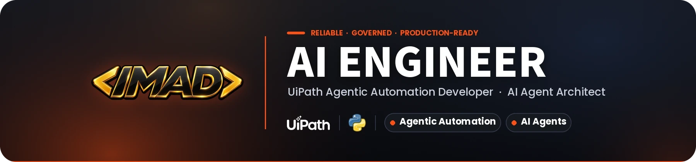

  

# Hi, I'm Imad Eddine Berjamy 👋

AI Engineer working on Automation projects from process assessment and solution design to development, deployment and production support.

My work includes UiPath architecture, REFramework, Dispatcher/Performer patterns, Orchestrator administration, reusable components, troubleshooting and production monitoring. I also help define development standards, review technical solutions and share best practices with automation teams.

I also work on RPA integration with Python, REST APIs, LLMs and AI agents. I build and test these approaches through technical prototypes and automation projects.

I work across the complete automation lifecycle: process assessment, solution design, development, testing, deployment, production support, root-cause analysis, and continuous improvement.

My experience includes:

- **Leading UiPath projects** and supporting automation teams
- **Designing robust REFramework** and Dispatcher/Performer architectures
- **Managing UiPath Orchestrator** environments, queues, assets, jobs, triggers, roles, and licenses
- **Establishing development, testing, documentation, and governance standards**
- **Diagnosing and resolving complex production incidents**
- **Integrating automations** with REST APIs, databases, Python, Playwright, and enterprise applications
- **Facilitating technical workshops** and sharing automation best practices as a Community Lead
- **Building proofs of concept & production agents** combining RPA, Generative AI, AI agents, and Agentic Automation

I am particularly interested in the convergence of RPA, APIs, AI agents, and human decision-making to build automation solutions that remain secure, maintainable, and scalable in production.

**Core technologies**: UiPath, Automation Anywhere, REFramework, Orchestrator, Maestro, AI Agents, Agentic Automation, Playwright, REST APIs, Python, SQL, Git/GitLab, Jira.

---

### 🏆 Certifications & Digital Credentials

Verified credentials and certificates (click any title to view the original):

**AI & Computer Science**
- **[CS50's Introduction to Artificial Intelligence with Python (CS50 AI)](https://certificates.cs50.io/cffd0815-3836-4671-8b81-60f865daa8f7.pdf?size=letter)** — Harvard University · 2026
- **[CS50x: Introduction to Computer Science](https://certificates.cs50.io/7aaeef13-f778-42aa-95a2-e10d808f7522.pdf?size=letter)** — Harvard University · 2024

**Automation & RPA**
- **[UiPath Certified Professional Agentic Automation Associate](https://credentials.uipath.com/2ddb04f2-5b08-42e2-bab2-40f370dafb8b)** — UiPath · Apr 2026
- **[Advanced Automation Certification](https://certificates.automationanywhere.com/7777e584-2c21-4bce-9515-63ac2daafa06)** — Automation Anywhere · Jan 2026
- **[SS&C Blue Prism Robotic Process Automation Professional Certificate](https://www.linkedin.com/learning/certificates/537eaf341fbe01e7a273089a60beff7e836dd64014d5dfb5700311f8736674eb)** — SS&C Blue Prism / LinkedIn Learning · May 2024

**Agile, Project Management & Professional Development**
- **[Atlassian Agile Project Management Professional Certificate](https://www.linkedin.com/learning/certificates/fa00ef77f7750aacd8a75d701e0dcda118c668fc6d0796322ebddc6af2ad9cbd)** — Atlassian / LinkedIn Learning · Feb 2025
- **[Scrum: Advanced](https://www.linkedin.com/learning/certificates/44726ccd8192469030acb2c47a502b998aa7c6a3caf7d453995a42942cca5f4b)** — LinkedIn Learning · Mar 2025
- **[McKinsey.org Forward Program](https://www.credly.com/badges/e69ccf7a-0d7a-4e57-8c4c-95ec75882cae)** — McKinsey.org · 2024

*Additional professional background: [LinkedIn](https://www.linkedin.com/in/berjamy/details/certifications/).*

---

### 🚀 Featured Project: NAVIA_PATH

> **"LLM decides, Python executes."**  
> *Prompt-driven browser automation for UiPath/RPA, powered by Python, Playwright and model-agnostic LLMs.*

**NavIA: Open-Source AI Browser Agent for RPA and Windows Workstations**

I built NavIA with Python and Playwright. It takes a prompt, observes the browser, chooses the next action through an agentic loop, and executes multi-step web tasks. NavIA can also be called from UiPath through reusable activities and return structured outputs to the workflow.

**Additional technical capabilities**
- Transforms natural-language objectives into multi-step browser actions.
- Model-agnostic backend supporting Google Vertex AI, Gemini, OpenAI GPT-4o, Claude 3.5 Sonnet, and Azure OpenAI.
- Shipped with ready-to-use native UiPath Studio activities for persistent Edge and Chrome automation.
- Zero external runtime dependency on target workstations.

👉 **[Explore NAVIA_PATH Repository](https://github.com/imadui/NAVIA_PATH)**

---

### 🛠️ Technical Toolkit

| Category | Technologies & Tools |
| :--- | :--- |
| **Automation & RPA** | UiPath Studio, Orchestrator, Automation Anywhere, REFramework, Maestro, Queues, Document Understanding |
| **Agentic AI & Web** | Playwright, Autonomous Browser Agents, Prompt Engineering, Function Calling |
| **Languages & Scripts** | Python, C#, VB.NET, PowerShell, SQL, Bash |
| **LLM & Cloud Providers** | Google Vertex AI, Google Gemini, OpenAI, Anthropic Claude, Azure OpenAI |
| **Protocols & Collaboration** | REST APIs, JSON/XML, Git/GitLab, Jira, Postman |

---

### 🌐 Languages

- **Arabic**: Native / Bilingual
- **French**: Fluent / Professional
- **English**: Fluent / Full Professional Proficiency

---

### 📬 Connect with Me

I'm open to technical collaborations and freelance opportunities around UiPath, RPA, AI integration, and Agentic Automation.

- **LinkedIn**: [linkedin.com/in/berjamy](https://linkedin.com/in/berjamy)
- **Email**: [imad.berjamy@outlook.com](mailto:imad.berjamy@outlook.com)
